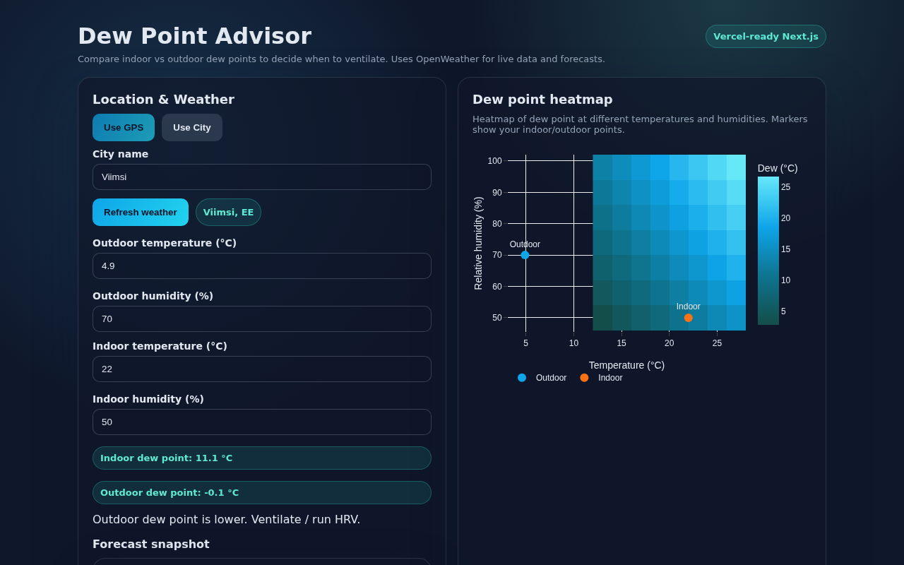

# Dew Point Advisor

Compare indoor vs outdoor dew points to decide when to ventilate. Uses OpenWeather for live data and forecasts, plus Estonian weather-station data.

**Live:** [https://dewpoint-ts.vercel.app](https://dewpoint-ts.vercel.app)



## Quickstart
1) Install deps (Node 20.19+):
```bash
npm install
```
2) Env:
```bash
cp .env.local.example .env.local
# add your key
OPENWEATHER_API_KEY=...
```
3) Run locally:
```bash
npm run dev
```
4) Run tests:
```bash
npm test
```

### Deploy on Vercel
- Push this repo to GitHub/GitLab.
- Import in Vercel (root of this repo). It will auto-detect Next.js.
- Set env var `OPENWEATHER_API_KEY`.

## Project layout
- `app/page.tsx` – client UI (geolocation or city input, dew point calc, heatmap).
- `app/api/weather/route.ts` – serverless route proxying OpenWeather current + forecast.
- `app/api/humidity/route.ts`, `app/api/beach/route.ts` – serverless routes for nearest Estonian weather-station humidity and coastal sea data.
- `lib/dewpoint.ts` – dew point math and recommendation helper.
- `lib/geo.ts` – distance and nearest-station helpers.
- `app/globals.css` – styling.

## How it was built

<!-- TODO: one hand-written paragraph -->

Method and agent configuration: [claudeconf](https://github.com/KristjanHS/claudeconf).

## License

MIT License - see [LICENSE](LICENSE) file.
